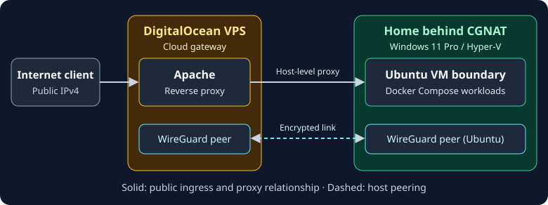

# Hybrid Homelab Infrastructure

**Public IPv4 ingress on a small VPS, application compute at home.**

I built this lab to get a containerized FastAPI application online and to learn self-hosting, networking and DevOps. My residential connection is behind carrier-grade NAT (CGNAT), so forwarding a port on my router alone would not give me a public IPv4 endpoint. I put Apache on a small DigitalOcean VPS for public ingress, paired the VPS with my home VM over WireGuard, and kept workloads on an Ubuntu guest running on Windows 11 Pro with Hyper-V.

## Project highlights

- **Separated ingress from compute.** The VPS handles public IPv4 entry and reverse proxying; the home VM runs FastAPI, n8n and other self-hosted workloads.
- **Deployed container workloads manually.** I used Docker Compose with bridge networking and named volumes. Persistence is not backup or tested recovery.
- **Kept cloud sizing focused on the edge.** The VPS does not need to run the home stacks. In return, public access to those workloads depends on both sites. Net savings and availability have not been measured.

## D02 Hybrid infrastructure at a glance

**How to read it:** Apache forwards toward the home VM boundary. The dashed line shows WireGuard peering, not a verified trace of any one request. FastAPI was the original public-access experiment; this diagram does not establish a current FastAPI or n8n route.

## Documentation

| Start here | What it covers |
| --- | --- |
| [Engineering documentation](docs/index.md) | Reading paths, all 17 sections, and evidence labels |
| [Requirements and traceability](docs/requirements.md) | Objectives and candidate acceptance checks |
| [Architecture and networking](docs/architecture.md) | Topology, HTTPS, virtualization, containers, and trust boundaries |
| [Infrastructure and services](docs/service-inventory.md) | Sanitized inventory and dependency evidence |
| [Operations and maintenance](docs/operations.md) | Monitoring, maintenance, and security review |
| [Engineering case study](docs/case-study.md) | Decisions, costs, limitations, and proposed architecture |

## Project status

This is a documentation-only case study of an implemented homelab, not a deployment bundle or live availability report. The design is operator-confirmed and selected platform indicators were previously observed. Per-route TLS, network policy and workload dependencies are not assumed. The [backup and recovery plan](docs/backup-and-recovery.md) is proposed, not implemented. Operational evidence and identifiers stay outside this repository.
