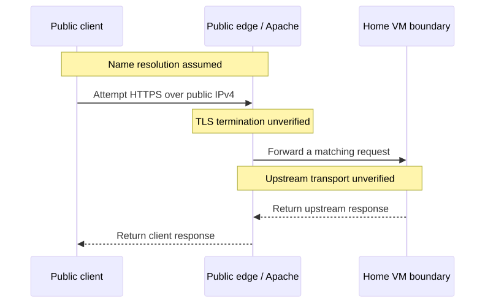

# Hybrid infrastructure architecture and network design

[Documentation index](index.md) · [Inventory](service-inventory.md) · [Operations](operations.md)

## 4. Hybrid infrastructure architecture

The [README overview (D02)](../README.md#d02-hybrid-infrastructure-at-a-glance) separates the public gateway from home compute. The DigitalOcean VPS hosts Apache, certificate tooling and one WireGuard peer. The home Ubuntu VM hosts the other peer and the application workloads. Apache's proxy relationship is confirmed to the home host boundary, not to an individual route or container.

### D01 System context

**Purpose:** Identify the actors and the constraint that shaped the architecture.

[Editable Mermaid source](diagrams/d01-system-context.mmd)

**How to read it:** Clients enter via the public edge. The operator link denotes responsibility, not an access method. The ISP boundary is why ingress and compute are placed at different sites.

## 5. Network topology

### D03 Network topology

**Purpose:** Separate public entry, the proxy relationship, and VPN peering.

[Editable Mermaid source](diagrams/d03-network-topology.mmd)

**How to read it:** Apache's arrow stops at the upstream host. The peer link does not specify which requests use it. Subnets, interfaces, route and NAT policy, and Hyper-V switch configuration are not inferred. Enabled Tailscale and Cloudflared services are not evidence of alternate ingress.

## 6. CGNAT problem and WireGuard solution

CGNAT puts an ISP-controlled NAT layer outside the router I manage. The VPS supplies public IPv4 entry independently of that router. Direct WireGuard peering provides an encrypted host-to-host link; it does not remove CGNAT or publish application ports. Peer placement is operator-confirmed, with a prior WireGuard interface observation on each host. Initiation, keepalive behavior, route selection and use by any specific upstream are unverified.

## 7. Public HTTPS request lifecycle

### D04 Public HTTPS request sequence

**Purpose:** Explain a conceptual successful public request, without asserting behavior for a live route.

[Editable Mermaid source](diagrams/d04-public-https-request-sequence.mmd)

**How to read it:** Name resolution and a successful response are illustrative, not the result of a trace. The edge lifeline shows a role, not how Apache handles the TLS handshake. The return arrows show response order, not routing policy. No upstream scheme or application endpoint is assumed.

## 8. Hyper-V virtualization architecture

### D05 Virtualization deployment

**Purpose:** Show the layers between the physical machine and the workloads.

[Editable Mermaid source](diagrams/d05-virtualization-deployment.mmd)

**How to read it:** The Windows/Hyper-V host must be available for the guest and its workloads. The virtual disk and the root LVM logical volume are distinct storage layers; neither is a measurement of filesystem free space. This view makes no claim about virtual switches, Docker volume backing paths, or snapshots.

## 9. Docker container architecture

### D06 Docker service dependencies

**Purpose:** Show deployment-layer dependencies without guessing which applications talk to each other.

[Editable Mermaid source](diagrams/d06-docker-service-dependencies.mmd)

**How to read it:** Bridge networks and named volumes represent the deployment pattern, not membership or use by every workload. Database and cache containers share the guest with applications, but their clients and startup dependencies are unverified. Named volumes retain state across container replacement when preserved and remounted, not when their backing storage is lost. See the [dependency register](service-inventory.md#dependency-evidence).

## 11. Reverse proxy and TLS architecture

- **Public Apache:** The operator confirms the reverse-proxy role. HTTP and WebSocket proxy, SSL, rewrite and headers modules were recorded as available; this does not establish their use on any specific route.
- **Certificates and TLS:** Let's Encrypt and Certbot are used for certificate management on the VPS. Challenge type, renewal health, TLS termination by route and any upstream TLS are unverified. WireGuard encryption and HTTPS are separate layers.
- **DNS:** Domain registration does not establish authoritative DNS hosting. The authoritative provider is unconfirmed; real names and records are omitted.
- **Home Apache:** A prior probe observed the local service active. Its role in a public request is unconfirmed. No current FastAPI, n8n, management, or data-service route is asserted.

## 12. Security design and trust boundaries

### D07 Security trust boundaries

**Purpose:** Separate untrusted public traffic, the VPS edge, and the home workload boundary.

[Editable Mermaid source](diagrams/d07-security-trust-boundaries.mmd)

**How to read it:** Boxes show logical trust zones, not enforcement. The final undirected line is an annotation, not a service route. WireGuard peer authorization is separate from application authentication and management access. UFW was listed as enabled at home, but effective firewall rules and reachability were not reviewed. See [security considerations](operations.md#security-considerations).
