# Engineering case study

[Documentation index](index.md) · [Architecture](architecture.md) · [Operations](operations.md)

## 13. Cost optimization rationale

I chose to rent a small VPS for the resource I did not have at home: public IPv4 ingress. I kept application compute and persistent workloads on hardware I already had. Compared with moving every workload to the cloud, this avoids sizing the VPS for the whole application estate. It does not establish net savings. A comparison would need the VPS bill, home electricity, hardware and storage costs, connectivity costs attributable to the design, and the time needed to operate both locations. No prices, savings, or performance figures are claimed.

## 14. Engineering decisions and trade-offs

I put Apache and WireGuard on the cloud side of the design, linked the VPS to the local Ubuntu guest, and used Hyper-V and Docker Compose to run the home workloads. Here is what those choices bought me and where they added work.

| Decision | Why I made it | Trade-off or alternative |
| --- | --- | --- |
| Public VPS plus home compute | Get public IPv4 while keeping application compute local. | All-cloud hosting would remove the home link from public service availability, but shift workload capacity into cloud spend. This design adds a cross-site dependency. |
| Apache reverse proxy plus WireGuard | Give the public edge and the encrypted host link distinct jobs. | The proxy route, TLS settings, and tunnel state have to be understood separately. A home port forward alone would not solve the upstream IPv4 constraint. |
| Ubuntu guest on Hyper-V | Keep Linux workloads on the Windows 11 Pro machine I already use. | The guest depends on Windows, Hyper-V, host resources and home power. A dedicated Linux host would change those dependencies and add hardware considerations. |
| Manual Docker Compose | Keep a practical way to deploy several personal stacks on one guest. | The operator coordinates releases and verifies them. Reproducible rollback and automated deployment have not been demonstrated. |
| Bridge networks and named volumes | Separate stack connectivity and retained data from container replacement. | Membership and data ownership still need a private inventory. A volume does not protect against host loss or deletion. |

## Evidence and verification

The original design and service placements come from my account and an existing sanitized inventory. A prior restricted probe only corroborated selected platform and service indicators. This case study does not use live endpoints or raw operational evidence. See [evidence labels](index.md#how-to-read-the-evidence) and [inventory](service-inventory.md#3-infrastructure-inventory).

The local documentation review covers figure rendering, links and fragments, and sensitive-information checks. It does not check live ingress, actual routing decisions, TLS behavior, alert delivery, backup coverage, deployment correctness, or application health. The [traceability matrix](requirements.md#requirements-traceability) lists suggested operational checks separately.

## 16. Known limitations

- Availability of a home-hosted service depends on the public edge, cross-site connectivity, home power and internet, Windows/Hyper-V, the Ubuntu VM, and the workload. No alternate path or failover was verified.
- The current inventory does not establish exact route mappings, upstream protocol, TLS termination by route, effective firewall policy, or administrative exposure.
- The inventory records placements and states, not a complete container dependency graph or workload health. Monitoring coverage and alert delivery are unconfirmed.
- No backup strategy is implemented in the recorded design. Recovery point, recovery time, and a successful restore are not established.
- There is no evidence of measured end-to-end performance, availability, or savings. Enabled GitLab Runner does not establish a deployment pipeline. Prometheus, Grafana, Terraform, Ansible, and Kubernetes are not verified as implemented.

## 17. Future improvements

### D08 Proposed future infrastructure architecture

**Purpose:** Show where I would add recoverability, verification, and reproducibility without redrawing them as deployed features.

[Editable Mermaid source](diagrams/d08-proposed-future-infrastructure-architecture.mmd)

**How to read it:** Solid blue boxes are existing roles. Dashed green boxes are proposed additions. Dotted links describe planned checks and data or configuration flows, not current connections. I would prove restoration before relying on a backup or adding deployment automation.

| Priority | Proposed change | What would count as done |
| --- | --- | --- |
| 1 | Privately verify selected routes, TLS handoffs and management access. | An authorized record identifies the actual proxy boundary, TLS behavior and exposure for each reviewed route. |
| 2 | Back up and restore one critical workload before expanding coverage. | A repeatable isolated restore recovers application state and records actual recovery point and elapsed time. See the [backup and recovery proposal](backup-and-recovery.md). |
| 3 | Define useful ingress and host checks. | Prove an approved alert fires and clears, and distinguish a gateway failure from a home workload failure. |
| 4 | Version deployment definitions and rehearse rollback in isolation. | A second deployment from reviewed inputs can be reproduced and rolled back without relying on undocumented host state. Evaluate automation tooling only if it reduces maintenance work. |
